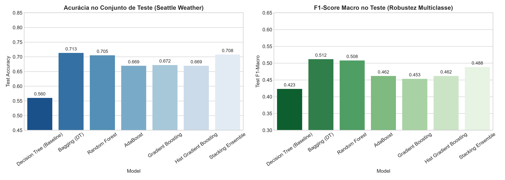
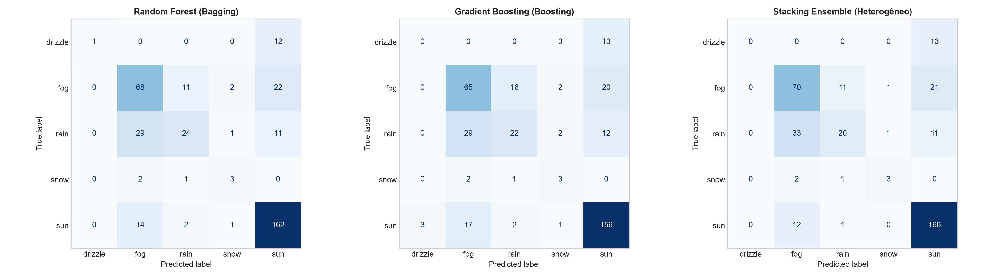
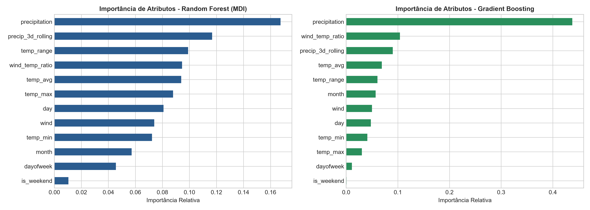
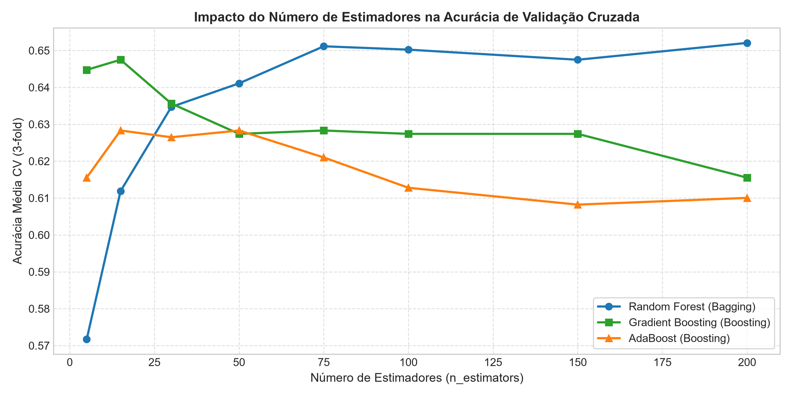

# Modelos Ensemble: Bagging, Boosting e Stacking no Dataset Seattle Weather

Exploração prática e estudo comparativo aprofundado dos três pilares clássicos de aprendizagem por comitês (*ensemble learning*) no **Scikit-Learn**: **Bagging** (`BaggingClassifier`, `RandomForestClassifier`), **Boosting** (`AdaBoostClassifier`, `GradientBoostingClassifier`, `HistGradientBoostingClassifier`) e **Stacking** (`StackingClassifier` com meta-aprendiz heterogêneo). O estudo é conduzido sobre a série meteorológica multivariada **`seattle_weather`** (`vega_datasets`).

---

## Integrantes (Dupla)

- **Cesar Gritti** — GitHub: [@Ce-22](https://github.com/Ce-22) — E-mail: cesargritti05@gmail.com
- **Pedro Isamu Yoshissaro** — GitHub: [@knutzin](https://github.com/knutzin) — E-mail: pedro.isamu2005@gmail.com

---

## Como executar

Requer Python 3.10 ou superior. Recomenda-se o uso de ambiente virtual isolado.

1. Instale as dependências:
   ```bash
   pip install -r requirements.txt
   ```
2. Abra e execute o notebook Jupyter principal:
   ```bash
   jupyter notebook lab_ensemble_bagging_boosting_stacking.ipynb
   ```
   *O arquivo `data/seattle_weather.csv` preserva uma cópia local do dataset, permitindo reprodução offline e independente de rede.*

---

## Principais Resultados e Comparações

O conjunto de dados `seattle_weather` apresenta **1.461 registros diários** distribuídos em 5 condições meteorológicas: `sun`, `fog`, `rain`, `drizzle` e `snow`. Todos os modelos foram avaliados sob divisão estratificada (75% treino / 25% teste holdout) e validação cruzada de 5 pastas estratificadas (`StratifiedKFold`).

| Modelo | Pilar Ensemble | CV Acurácia (5-Fold) | Teste Acurácia | Teste F1-Macro | Teste F1-Weighted |
| :--- | :--- | :---: | :---: | :---: | :---: |
| **Bagging (DT - 100 estimadores)** | **Bagging** | 0,6594 | **0,7131** | **0,5118** | **0,6908** |
| **Stacking Ensemble (Heterogêneo)** | **Stacking** | **0,6648** | **0,7077** | 0,4883 | 0,6769 |
| **Random Forest (`sqrt` features)** | **Bagging** | 0,6612 | **0,7049** | 0,5079 | 0,6831 |
| **Gradient Boosting (GBDT)** | **Boosting** | 0,6521 | 0,6721 | 0,4533 | 0,6517 |
| **Hist Gradient Boosting** | **Boosting** | 0,6511 | 0,6694 | 0,4618 | 0,6499 |
| **AdaBoost (`SAMME`)** | **Boosting** | 0,6265 | 0,6694 | 0,4616 | 0,6550 |
| *Decision Tree (Baseline individual)* | *Nenhum (Árvore única)* | 0,5361 | 0,5601 | 0,4232 | 0,5606 |

### Destaques da Análise

- **Salto sobre o Baseline Individual:** A árvore de decisão isolada (`DecisionTreeClassifier`) obteve acurácia de apenas **56,01%** e sofreu severo sobreajuste às flutuações amostrais. Qualquer abordagem ensemble elevou a acurácia para a faixa de **66,9% a 71,3%**, superando o baseline em até **+15,3 pontos percentuais**.
- **Pilar 1 — Bagging e Redução de Variância:** Tanto o `BaggingClassifier` puro (**71,31%**) quanto o `RandomForestClassifier` (**70,49%**) demonstraram a maior estabilidade e o maior F1-Macro (**0,5118**), comprovando a eficácia do sorteio bootstrap com reposição para suavizar a sensibilidade a ruídos climáticos diários.
- **Pilar 2 — Boosting e Redução de Viés:** O `GradientBoostingClassifier` e o `HistGradientBoostingClassifier` alcançaram **67,21%** e **66,94%**, convergindo com alta precisão na separação de chuva (`rain`) e sol (`sun`), superando o `AdaBoost` com menor sensibilidade a outliers de vento.
- **Pilar 3 — Stacking Heterogêneo:** A combinação em dois níveis de **Random Forest + SVM (RBF) + Rede Neural Artificial (MLP 64x32) + HistGradientBoosting** com um meta-classificador de **Regressão Logística** obteve a maior acurácia em validação cruzada (**0,6648**) e **70,77%** no teste, aproveitando a complementaridade entre fronteiras lineares, hiperplanos de margem máxima e particionamentos ortogonais de árvores.

---

## Visualizações

### 1. Comparativo Geral de Acurácia e F1-Macro


### 2. Matrizes de Confusão nos Três Pilares


### 3. Importância de Atributos (Feature Importance)
A análise MDI (*Mean Decrease in Impurity*) no Random Forest e os gradientes no Gradient Boosting revelam que o volume diário de precipitação (`precipitation`), a amplitude térmica (`temp_range`) e a média móvel de chuva recente (`precip_3d_rolling`) são os fatores mais determinantes para predizer o clima de Seattle.


### 4. Sensibilidade ao Número de Estimadores ($n\_estimators$)


---

## Limitações e Desbalanceamento

O conjunto de dados apresenta expressivo desbalanceamento de classes: dias de sol (`sun`, 714) e neblina (`fog`, 411) representam mais de 75% das amostras, enquanto garoa (`drizzle`, 54) e neve (`snow`, 23) são classes raras. Embora o Bagging e o Stacking tenham alcançado acurácias superiores a 70%, o F1-Score macro reflete a dificuldade de generalizar para as classes minoritárias sem técnicas adicionais de reamostragem sintética (como SMOTE) ou ajuste explícito de custos/pesos (`class_weight='balanced'`).

---

## Fontes e Referências

- **Vega Datasets (`seattle_weather`):** https://github.com/vega/vega-datasets
- **Scikit-Learn Ensemble Methods:** https://scikit-learn.org/stable/modules/ensemble.html
- **GeeksforGeeks — Bagging vs Boosting vs Stacking:** https://www.geeksforgeeks.org/machine-learning/bagging-vs-boosting-vs-stacking/
- **GeeksforGeeks — Boosting in Machine Learning:** https://www.geeksforgeeks.org/machine-learning/boosting-in-machine-learning/
- **Russell, S., & Norvig, P. (2020).** *Artificial Intelligence: A Modern Approach (4th ed.)*. Pearson.
